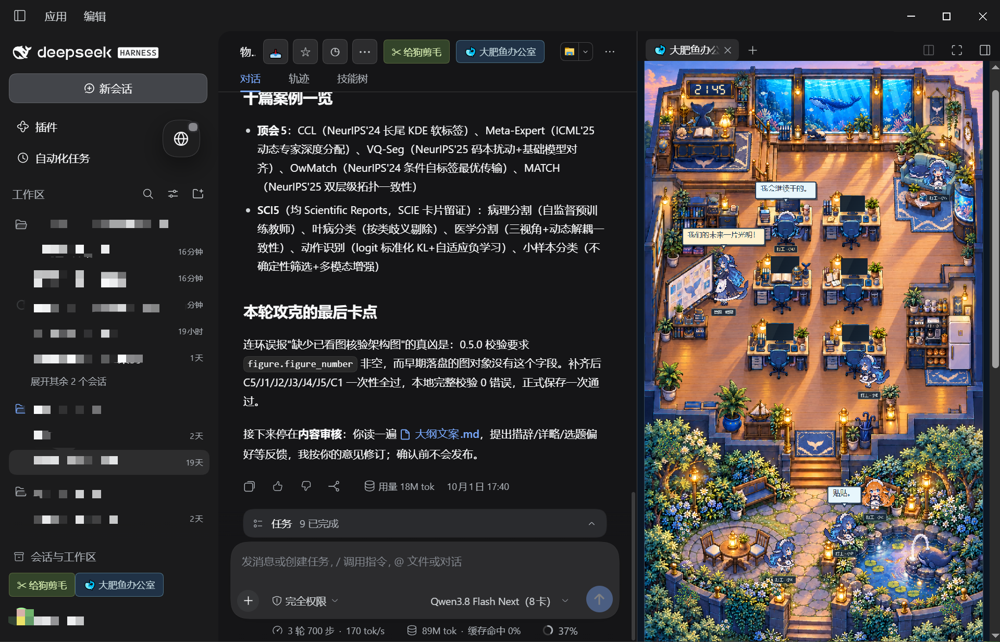

# 大肥鱼办公室 · dsh-fish-office

本插件支持在 DeepSeek Harness 右侧打开一间像素风格的鲸鱼娘办公室，显示真实任务与多智能体的工作状态。

<table>
  <tr>
    <th align="center">白天</th>
    <th align="center">黄昏</th>
    <th align="center">夜晚</th>
  </tr>
  <tr>
    <td width="33%" valign="top"></td>
    <td width="33%" valign="top"></td>
    <td width="33%" valign="top"></td>
  </tr>
</table>

## 员工图鉴


## DeepSeek Harness 插件效果


## 从 GitHub 安装

需要 DSH 0.2.1-rc.2 或同系列后续版本，Node.js 22.19+（22.x）或 24+。

桌面版：打开 DSH 的插件管理，选择安装插件，填写 `github:Hjy0714/dsh-fish-office`。

Web 版：

```sh
npx @deepseek-ai/dsh@0.2.1-rc.2 plugin --profile web add github:Hjy0714/dsh-fish-office
```

安装后重启 DSH，点击“🐋 大肥鱼办公室”。仓库自带构建产物，无需 npm 发布或手动构建。

## 自定义

修改 `~/.dsh/fish-office-config/` 中的 `员工档案.json` 和 `对白库.json`，可自定义姓名、介绍与对白，保存后自动生效。设置 DSH_HOME 时，配置位于该目录下的 fish-office-config。

仓库内的默认配置只保留在 `config/`，源码与安装包共用。

## 开发

```sh
npm ci --ignore-scripts
npm run build
npm test
```

源码修改后，同步提交 lib/ 中的构建产物。

## 许可证

[MIT](LICENSE)，代码与随包美术均可使用。
